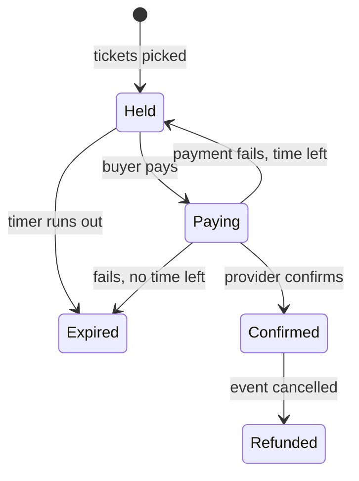

# TicketDrop: Agent Guide

A web platform where organizers sell a fixed number of tickets at a set on-sale time. Buyers compete
fairly, and the site neither oversells nor goes down.

**Headline claim:** zero oversells, however many buyers arrive at once.
**Resume line it must earn:** *Simulated a drop of N concurrent buyers for M tickets: zero oversells, p95
time to secure a hold under X ms.* (N, M, X are measured later, never invented.)

This is a **portfolio and learning project**. The real audience is a hiring manager in Vienna (the
"Reviewer" role). The owner must be able to explain and defend every design decision in an interview, and
that shapes how agents should work here.

---

## 1. How to work in this repo (read first)

### Agent role: pair / mentor, not autopilot
- **Agents may implement directly:** boilerplate, config, build/CI/Docker setup, DTOs, wiring, test
  scaffolding, docs and refactors.
- **Core logic is the owner's to write or explicitly approve.** For these areas, explain the options and
  trade-offs, propose a shape, and let the owner write or sign off on the key pieces:
  - inventory / oversell protection and holds (2.2, 2.4, 3.2)
  - queue, admission and fairness (3.1)
  - the order state machine (2.3)
  - payments and webhooks (3.3, 3.4, 5.3)
  - auth, sessions and authorization checks (section 1)
  - ticket signing and check-in (2.5, 5.2)
- Explain the *why*, and point to the matching entry in `docs/Research topics.pdf` when a concept is new.

### Decisions
- **Never decide D1–D8 alone** (see §6). Present 2–3 options with trade-offs and wait for the owner's
  choice. Then write an ADR.
- Tech-stack-doc picks that aren't in the code yet are **defaults, not decisions**. Adopt one only via an ADR
  that the owner approves.
- Changing a default value from §4 must be written down (ADR or README), per the requirements doc.

### Workflow
- New feature: brainstorm first (Superpowers), then enter plan mode so I review in Plannotator.
- Any architecture or data-flow explanation: use visual-explainer, not ASCII.
- Pure functions, parsers, serializers: add property-based tests (fast-check).
  - Backend (Java) equivalent: **jqwik**.
- After implementing: run code-simplifier, then show me the diff before committing.
- Before writing code that uses a concept I haven't used in this repo: stop and ask me.

### Commits & PRs (req 7.6)
- Small, described commits. Reference story IDs, e.g. `2.2: enforce sold+held <= quantity`.
- Each PR names the story IDs it implements. Never commit unless asked.

---

## 2. Source documents

| File | Use |
|---|---|
| `docs/Ticket Drop Platform — Requirements (v1).pdf` | **Source of truth.** Stories with Must/Should/Could, acceptance criteria, defaults, open decisions, definition of done. |
| `docs/Tech stack.pdf` | Recommended stack per layer, with reasons (Vienna job-market data). Defaults only. |
| `docs/Research topics.pdf` | Topic names per story for when stuck (no solutions). Use it to point the owner at concepts. |
| `README.md` | ADR index (decisions 1–5 so far). Will become the reviewer-facing README (7.1). |

If this file and the requirements PDF disagree, the PDF wins. Update this file when that happens.

---

## 3. Roles & glossary

| Role | Can |
|---|---|
| Buyer | (verified account) queue, hold and buy tickets; see own tickets |
| Organizer | create events and tiers, schedule drops, see own sales/attendees, invite door staff |
| Door staff | (invited per event) check in tickets for assigned events only |
| Admin | suspend organizers/events, see platform health |
| Reviewer | hiring manager, no account: try the demo, read docs, run locally |

| Term | Meaning |
|---|---|
| Drop | The on-sale moment and the rush that follows |
| Queue | Where buyers wait before and during a drop |
| Admission | Letting one buyer from the queue into ticket selection |
| Hold | Tickets reserved for one buyer for a limited time |
| Order | One purchase of one or more tickets |
| Ticket | One entry right, shown as a signed QR code |
| Check-in | Door staff scanning a ticket at entry |

---

## 4. Defaults

| Parameter | Default | Set by |
|---|---|---|
| Hold duration | 10 min | Organizer, 5–15 min |
| Admission window (time to start a hold) | 5 min | Platform |
| Tickets per order | Up to 4 | Organizer |
| Tickets per buyer per event | Up to 4 | Organizer |
| Queue opens | 30 min before on-sale | Platform |
| Admission rate | e.g. 100 buyers/min | Organizer |
| Ticket email delivery | Within 2 min of confirmation | Platform |
| Door-staff invites | Single use, expire after 7 days | Platform |
| Event images | JPEG, PNG or WebP, max 5 MB | Platform |
| Idle session timeout | 14 days | Platform |
| Backups | Daily, kept 7 days | Platform |

Other fixed numbers: verification links 24 h, single use; reset links 1 h, single use, sign out other
sessions; lockout after 5 failed sign-ins in 15 min, for 15 min; door-staff access ends 24 h after the event;
stuck payments are checked after 15 min; step-up auth after 15 min (1.7).

---

## 5. Core rules

### Order state machine (2.3)

Only these transitions, plus the one D1 defines (payment confirms after expiry), are allowed.

### Invariants that must never break
- **No oversell:** per tier, `sold + actively held <= quantity`, at every moment, under any load. When
  two buyers race for the last ticket, exactly one wins and the other is told none are available.
- **Per-buyer cap:** held + confirmed per buyer per event never exceeds the limit, across tabs, devices and
  orders. One account holds at most one place per queue.
- **Quantities:** after the drop starts, prices are locked and quantities only go up, never below sold + held.
- **Payments:** an order is confirmed only by a *verified* provider notification, never by the browser.
  Every notification is stored as received. Duplicates confirm once and send one email. Out-of-order
  notifications still end in the right state. Replays create nothing new. Prices always come from the
  server. Card data never touches the platform.
- **Money ↔ tickets:** no buyer is charged without tickets or a refund. No ticket exists without a payment.
- **History:** orders and tickets are never deleted. Every change is recorded with a time and a reason.
  Sold/held counts can be rebuilt from history (2.6).
- **Check-in:** each ticket admits once. Concurrent scans mean exactly one succeeds. A second scan shows
  "already checked in" with the time and scanner. Refunded tickets scan as invalid. Forged, altered or guessed codes are invalid.
- **Access control:** every action is checked for role **and** ownership. Another user's resource returns
  the same response as a non-existent one (no IDOR/BOLA). Door staff see only the result, tier and name.
- **Server-side everything:** all limits and validation are enforced on the server. Errors list each invalid
  field and never leak stack traces or queries. User text renders as plain text.
- **Background work** survives restarts and is safe to run twice (expiry, admission, emails, refunds).
- **Secrets** are never committed. Every setting is documented with a safe example value.

---

## 6. Open decisions: ALL OPEN, owner decides

| ID | Question | Status |
|---|---|---|
| D1 | A payment confirms after its hold expired, and the tickets may be gone. What happens? | OPEN |
| D2 | Buyers who arrive before on-sale: ordered by arrival, or randomly when the sale opens? | OPEN |
| D3 | How does a buyer keep one place across reloads and devices, and what stops one person queuing many times? | OPEN |
| D4 | How do live updates reach the browser, and what happens when that connection drops? | OPEN |
| D5 | Where is the no-oversell rule (2.2) enforced, and how do you prove it holds under concurrency? | OPEN |
| D6 | How are tickets made unforgeable (5.2)? | OPEN |
| D7 | What is the smallest architecture that meets the load target: one service or several? | OPEN |
| D8 | How do public demo drops (6.4) stay within budget? | OPEN |

**ADR rules (7.2):** every decision gets a record with context, options considered, choice, and
consequences. Records are dated and never rewritten. A changed decision gets a new record that supersedes the
old one. Add each ADR to the index in `README.md`. (An ADR folder location isn't fixed yet. Ask before creating one.)
Update the status column above when a decision is made.

---

## 7. Requirements map (story IDs)

M = Must, S = Should, C = Could. Cite these IDs in commits, tests and ADRs.

1. **Auth & authz:** 1.1 Verified account (M) · 1.2 Sign in/out/reset (M) · 1.3 Organizers see only own
   events (M) · 1.4 Buyers see only own orders (M) · 1.5 Door staff scoped to one event (M) · 1.6 Admin
   suspension (S) · 1.7 Recent sign-in for sensitive actions (C)
2. **Domain & data:** 2.1 Events and tiers (M) · 2.2 Never oversell (M) · 2.3 One clear order state (M) ·
   2.4 Per-buyer limit (M) · 2.5 One entry per ticket (M) · 2.6 Explainable numbers (S)
3. **Async work:** 3.1 Queue admission (M) · 3.2 Hold expiry (M) · 3.3 Payment confirmation (M) · 3.4 Stuck
   payments resolved (S) · 3.5 Ticket delivery (M) · 3.6 Refunds on cancellation (S)
4. **Frontend state:** 4.1 Honest availability (M) · 4.2 Queue position (M) · 4.3 Hold countdown (M) · 4.4
   Payment result (M) · 4.5 Connection loss (M) · 4.6 My tickets (M) · 4.7 Organizer live dashboard (S) · 4.8
   Door scanner (M) · 4.9 Accessibility (M) · 4.10 Speed (S)
5. **Security:** 5.1 Bot and scalper limits (M) · 5.2 Unforgeable tickets (M) · 5.3 Trustworthy payments (M)
   · 5.4 Safe image uploads (M) · 5.5 Safe attendee export (S) · 5.6 Validated input (M) · 5.7 Account
   protection (M) · 5.8 Minimal personal data (S)
6. **Shipping:** 6.1 One-command local setup (M) · 6.2 Checked PRs (M) · 6.3 Deploys with automatic
   rollback (M) · 6.4 Public demo drop (S) · 6.5 Observability (M) · 6.6 Restored backups (M) · 6.7 Secrets
   out of the repo (M) · 6.8 Cost ceiling (S)
7. **Docs:** 7.1 README that sells (M) · 7.2 Decision records (M) · 7.3 API reference (M) · 7.4 Load test
   report (M) · 7.5 Runbook (S) · 7.6 Readable history (S)
8. **Tests:** 8.1 Oversell test (M) · 8.2 Payment edge cases (M) · 8.3 Access-control matrix (M) · 8.4
   Time-based rules (M) · 8.5 End-to-end journey (M) · 8.6 Load test (M) · 8.7 Frontend states (S) · 8.8 Known
   attacks (S)

**Out of scope for v1:** seat maps, resale/transfers, real money, multiple currencies, native apps, dynamic
pricing, post-sell-out waitlists, offline scanning.

**Frontend baseline (section 4):** every screen has designed loading, empty and error states. Never show a blank
page or a stale "available". The countdown follows server time, not the device clock.

**Definition of done (v1):** every Must story meets its criteria. The live demo is up (payments in test mode). The load test
report shows zero oversells at the target load. Rollback and a backup restore have each been demonstrated once.
The README, API reference and an ADR per open decision are published. CI is green on main and every Must story links to at
least one test. The resume line is filled in with measured numbers.

---

## 8. Architecture & stack

### Decided (README ADR index)
1. Backend: **Java + Spring Boot** (rejected: NestJS, ASP.NET Core, FastAPI)
2. Frontend: **React** (rejected: Angular)
3. Delivery: **Vite single-page app** (rejected: Next.js)
4. Repo: **one repo, `frontend/` + `backend/` side by side** (rejected: separate repos, Nx/Turborepo)
5. Frontend structure: **feature-based** (`app/`, `features/`, `pages/`, `shared/`)

Also in the code already: PostgreSQL, Flyway, Spring Data JPA, Bean Validation, Actuator, TanStack Query,
JUnit + Testcontainers, Docker Compose.

### Defaults from `docs/Tech stack.pdf`, not adopted yet (each needs an ADR)
| Layer | Default | Alternative | Related |
|---|---|---|---|
| Cache / rate limits / queue counters | Redis | Valkey | D3, D5, 5.1 |
| Background jobs | RabbitMQ | DB-backed job queue, SQS | D7 |
| Live updates | SSE or WebSockets | (polling) | D4 |
| Auth | Spring Security | Keycloak | section 1 |
| Payments | Stripe test mode | none | 3.3, 5.3 |
| Email | Transactional email API, Mailpit locally | none | 3.5 |
| File storage | S3, LocalStack/Garage locally (**not MinIO**) | none | 5.4 |
| CI/CD | GitHub Actions | GitLab CI | 6.2, 6.3 |
| Hosting / IaC | AWS / Terraform (optional) | Azure / OpenTofu | 6.3 |
| Observability | OpenTelemetry → Prometheus, Loki, Tempo, Grafana | Grafana Cloud | 6.5 |
| Tests | Vitest (FE), Playwright (E2E), k6 (load) | Gatling | section 8 |
| Docs | OpenAPI generated from code, Mermaid, Markdown ADRs | none | 7.2, 7.3 |

**Left out on purpose:** Kafka, Kubernetes, microservices (start as one service unless a load test proves
otherwise, D7), MinIO.

---

## 9. Repo layout & current state (as of 2026-11-08)

```
backend/     Spring Boot 4.1.2, Java 21, Maven wrapper
  src/main/java/io/github/johanneshenz/ticketdrop/
    TicketdropApplication.java
    controllers/TestController.java     GET / → hello string (placeholder)
  src/main/resources/application.properties
  src/test/java/.../                     contextLoads test + Testcontainers Postgres config
  compose.yaml                           Postgres, used by spring-boot-docker-compose on run
frontend/    React 19, TypeScript ~6, Vite 8 + React Compiler, TanStack Query 5
  src/app/App.tsx                        QueryClientProvider root
  src/pages/Homepage.tsx                 fetches backend GET / (placeholder)
  src/features/{queue,checkout}/         empty stubs (index.ts, types.ts)
  src/shared/, src/assets/               present but empty / untracked
docker-compose.yaml                      root compose: frontend, backend, postgres (WIP)
docs/                                    requirements, tech stack, research topics (PDFs)
```

The project is at the walking-skeleton stage: there's no domain code, no schema and no auth yet.

**Known gaps. Flag them, don't silently "fix" them:**
- `application.properties` sets `spring.jpa.hibernate.ddl-auto=update` while Flyway is on the classpath.
  Flyway migrations should own the schema (likely `validate`). Raise it before the first entity.
- There are two compose files. The root `docker-compose.yaml` references empty `backend/Dockerfile` and
  `frontend/Dockerfile`, and Postgres env vars are commented out. One-command setup (6.1) isn't done.
- `.env.example` is empty. The root `.gitignore` only lists `.env`. `.vscode/launch.json` loads `${workspaceFolder}/.env`.
- The frontend hard-codes `http://localhost:8080`. `TestController` uses `@CrossOrigin` with no origin restriction.
- There's no CI yet (6.2) and no frontend test runner installed.

---

## 10. Commands

```bash
# Backend (from backend/)
./mvnw spring-boot:run        # auto-starts Postgres from backend/compose.yaml (Docker required)
./mvnw test                   # JUnit + Testcontainers (Docker required)
./mvnw -DskipTests package

# Frontend (from frontend/)
npm install
npm run dev                   # Vite dev server
npm run build                 # tsc -b && vite build
npm run lint                  # ESLint
npm run format                # Prettier write  (format:check to verify)
```

Environment: WSL2 on Windows, repo on `/mnt/c/...`, Node via nvm (v22). File watching and I/O on `/mnt/c` can be slow.

---

## 11. Conventions

**Frontend**
- Prettier: tabs, single quotes, semicolons, no trailing commas. Run `npm run format` (some older files still
  use spaces).
- Feature folders (`features/<name>/`) expose a public API via `index.ts`. Pages compose features. Shared
  code goes in `shared/`.
- Server state lives only in TanStack Query, never copied into local state. Local UI state is separate.
- Never show a loading value as real data. Status is never conveyed by color alone (4.9).

**Backend**
- Base package `io.github.johanneshenz.ticketdrop`. Package-by-feature vs by-layer isn't decided yet, so ask.
- Schema changes go through Flyway migrations only.
- Money is stored in minor units (integer cents) or `BigDecimal`, never `double`/`float`.
- Times use IANA zone names. Event times are shown in the event's zone.
- Inject a `java.time.Clock` into anything time-based, so deadlines are testable without waiting (8.4).
- Validate every request DTO with Bean Validation. Return field-level error lists.

---

## 12. Testing strategy (section 8)

The tests should prove the risky rules, not chase a coverage percentage.
- **8.1 Oversell test:** e.g. 200 concurrent hold attempts for 10 tickets, exactly 10 succeed. It also covers holds
  expiring during new holds. It runs on every PR, and any oversell fails the build.
- **8.2 Payment edge cases:** duplicate, out-of-order, forged and late notifications, plus fail-then-retry. After each, the money and tickets
  must match.
- **8.3 Access-control matrix:** every role (including signed-out) × every protected action, including other users'
  resources, written as table-driven tests. A new protected action without an entry fails the build.
- **8.4 Time rules:** check just before, at and just after each deadline, using an injected clock. These run in seconds.
- **8.5 E2E (Playwright):** sign-up → queue → hold → test payment → email → scan OK → second scan rejected.
- **8.6 Load (k6):** N buyers / M tickets. It passes only with 0 oversells, 0 double charges, <1% errors and p95 under target.
  Results are saved with the date and commit.
- **8.7 / 8.8:** a test per frontend state, automated a11y checks, and known-attack tests.

Tools: JUnit 5 + Testcontainers (real Postgres) + **jqwik** for backend properties. Vitest + **fast-check**
for the frontend (not installed yet).

---

## 13. Installed agent tooling, and when to use it

- **superpowers:brainstorming**: before any new feature, then plan mode → **Plannotator** review.
- **visual-explainer**: architecture/data-flow explanations, diff and plan reviews, state machines.
- **Trail of Bits:** `insecure-defaults` (config/secrets), `differential-review` (security review of
  diffs), `static-analysis` (Semgrep/CodeQL), `sharp-edges` (footgun APIs/config).
- **code-simplifier**: after implementing, before showing the diff.
- **typescript-lsp**: code navigation and diagnostics in `frontend/`.
- **context7**: up-to-date library docs (Spring Boot 4, Vite 8, TanStack Query, etc.). Prefer it over memory.
